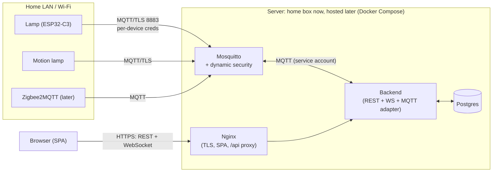
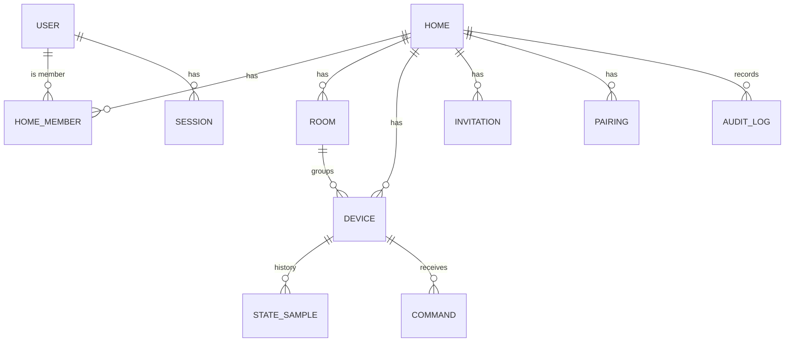
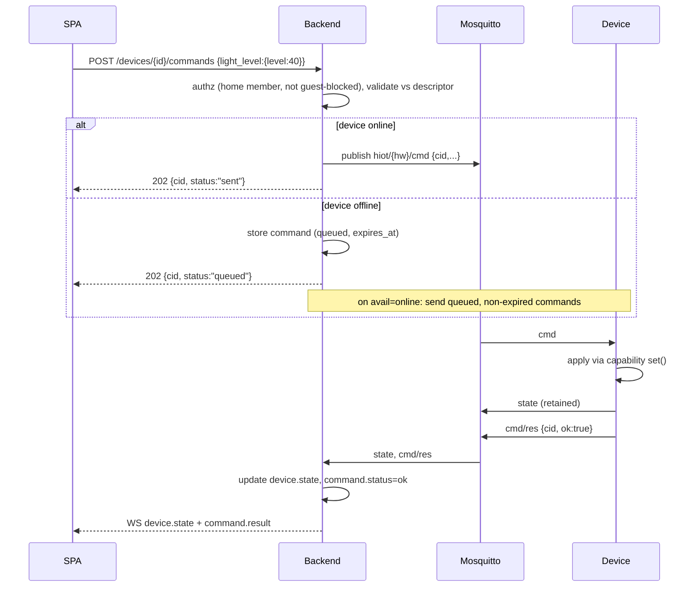
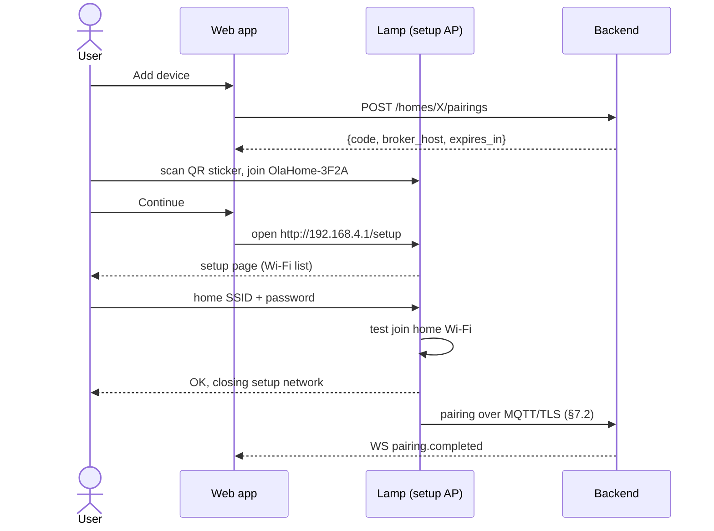
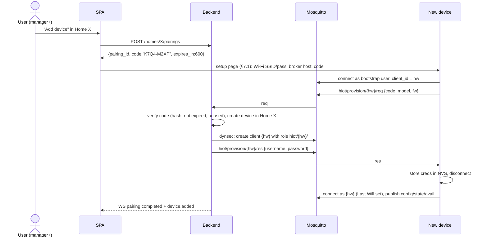
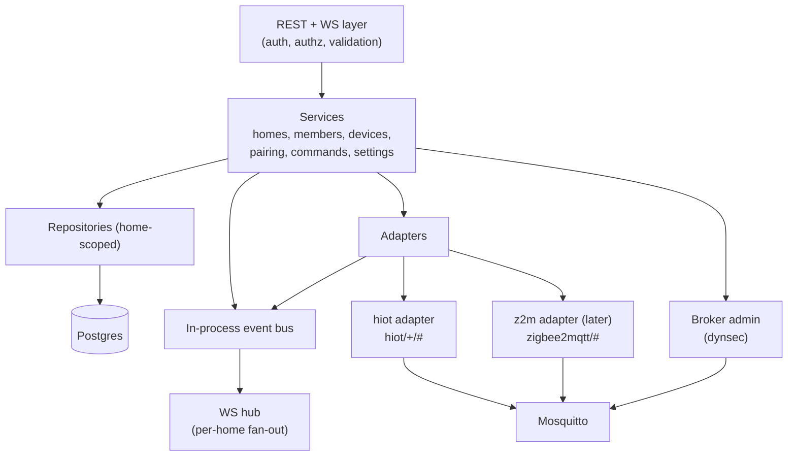

# Server specification (draft v0.1)

Status: **draft for discussion**. Once agreed, the MQTT part replaces the
earlier draft in [`protocol/topics.md`](../../protocol/topics.md), and the
JSON shapes here become schemas in [`protocol/schemas/`](../../protocol/schemas/).

Decided: **Python + FastAPI** backend, **several households per server** (§2.1),
**short queue for offline commands** (§5.5), **SoftAP + QR Wi-Fi setup** for every
phone (§7.1), **MQTT over TLS** (§12.1). Status of every decision is in §13.

---

## 1. Scope and principles

The server ("backend") is the only component that knows about **users, homes and
permissions**. It:

- keeps the registry of users, homes, rooms, members and devices (Postgres)
- talks to devices **only through the MQTT broker** (Mosquitto)
- exposes a **REST API** (CRUD, commands) and a **WebSocket** (live updates) to the web SPA
- manages **device credentials** on the broker (pairing, removal)
- stores last-known device state and a short history

Principles:

1. **Capabilities, not device types.** The server never has `if (type == "lamp")`.
   It stores whatever capabilities a device describes and passes them to the SPA,
   which renders widgets per capability type.
2. **Devices don't know about homes or users.** A device knows only its own ID and
   broker credentials. Moving a device to another home is a server-side change only.
3. **Local first.** Devices keep working (local buttons, local behaviors) when the
   server or network is down. The server never assumes it is the only source of changes.
4. **Deny by default.** Every API call and every MQTT topic is scoped. A user sees
   only homes they are a member of. A device can only touch its own topics.
5. **Everything from outside is untrusted**, including device payloads. Validate
   against JSON schemas and size limits on the way in.
6. **Keep it simple.** One backend process, one Postgres, one broker. Nothing in
   this spec needs Redis, Kafka or microservices.

## 2. Architecture



- The browser **never** connects to the broker. Only the backend translates between web and MQTT.
- Postgres is never reachable from outside the server.
- The backend uses an **adapter** per device source (§10). The first adapter is
  `hiot` (our firmware over MQTT). Zigbee2MQTT comes later as a second adapter.

### 2.1 Tenancy and deployment modes

One server hosts **several households**. Each household is one or more **homes**,
and homes are fully isolated from each other (§4, §6.3). The same code and the
same firmware run in both deployment modes. Only addresses and certificates change.

| | **Local** (now) | **Hosted** (later) |
|---|---|---|
| Where | Raspberry Pi / mini PC on the home LAN | VPS or cloud VM |
| Devices reach the broker | over home Wi-Fi to a LAN address (`ola.lan:8883`) | over the internet to `mqtt.<domain>:8883` |
| Users reach the web app | LAN, or remotely via Tailscale/WireGuard | public HTTPS `https://<domain>` |
| Broker exposed | LAN only | port 8883 public, **TLS + per-device login required**, connection rate limits |
| Certificates | own CA (§12.1) | Let's Encrypt |
| Who signs up | admin creates users / invitations | same, open sign-up with email verification is an option |

Devices never have the server address hardcoded: they get the broker host during
provisioning (§7), so moving from local to hosted only means re-provisioning
(or a later "change server" command).

## 3. Domain model



| Entity | Purpose | Key fields |
|---|---|---|
| **user** | A person who logs in | `id`, `email` (unique), `display_name`, `password_hash` (argon2id), `is_admin`, `disabled_at`, `created_at` |
| **session** | Login session (opaque token in cookie) | `id`, `user_id`, `token_hash`, `created_at`, `last_seen_at`, `expires_at`, `user_agent`, `ip` |
| **home** | A set of devices (an apartment, a cottage, "lab bench") | `id`, `name`, `timezone`, `created_at` |
| **home_member** | User's role in a home | `home_id`, `user_id`, `role`, `device_allowlist` (guest only), `expires_at` (guest only) |
| **invitation** | Pending invite into a home | `id`, `home_id`, `email`, `role`, `token_hash`, `expires_at`, `invited_by` |
| **room** | Optional grouping inside a home | `id`, `home_id`, `name`, `sort_order` |
| **device** | A physical (or bridged) device | `id` (uuid), `hw_id` (from `hwinfo`, unique), `home_id`, `room_id`, `name`, `icon`, `adapter` (`hiot`/`z2m`), `model`, `fw_version`, `descriptor` (jsonb, last `config`), `state` (jsonb, last `state`), `settings_desired` (jsonb), `settings_rev`, `online`, `last_seen_at`, `created_at` |
| **pairing** | One-time "add a device" session | `id`, `home_id`, `code_hash`, `created_by`, `expires_at`, `status`, `device_id` |
| **command** | Command sent to a device: offline queue, correlation, audit | `id` (= `cid`), `device_id`, `user_id`, `payload`, `status` (`queued`/`sent`/`ok`/`error`/`timeout`/`expired`/`superseded`), `expires_at`, `created_at`, `sent_at`, `completed_at` |
| **state_sample** | History for capabilities that need it (sensors, energy) | `device_id`, `cap_id`, `ts`, `value` (jsonb) |
| **audit_log** | Who did what | `id`, `home_id`, `user_id`, `action`, `target`, `details`, `ts` |

Notes:
- IDs are UUIDv7 (sortable). `hw_id` is a separate field and never used as the API ID,
  so a device can be removed and re-paired cleanly.
- Capabilities are stored as **jsonb on the device** (`descriptor`), not as separate
  tables. They come from the device and change only on firmware updates. If the
  SPA later needs filtering by capability, add a GIN index first, not a table.
- Retention: `state_sample` 30 days, `command` 7 days, `audit_log` 1 year (configurable).
  A daily cleanup job deletes old rows.
- Postgres row-level security isn't needed at first: all access goes through one
  "home scope" layer in the backend (§6.3).

## 4. Roles and permissions

Two levels:

**Instance level** (the whole server)
- `admin` (`user.is_admin`): manages users and instance settings and sees system health.
  **By default an admin can't see the devices in someone else's home.** Being admin is
  not the same as being a home member. This keeps households private from each other on a shared server.

**Home level** (`home_member.role`)

| Permission | owner | manager | member | guest |
|---|:-:|:-:|:-:|:-:|
| View home, rooms, devices, state | ✅ | ✅ | ✅ | allowlisted devices only |
| Control devices (commands) | ✅ | ✅ | ✅ | allowlisted devices only |
| Change device settings | ✅ | ✅ | ❌ | ❌ |
| Rename / move device, CRUD rooms | ✅ | ✅ | ❌ | ❌ |
| Add (pair) / remove devices | ✅ | ✅ | ❌ | ❌ |
| View history | ✅ | ✅ | ✅ | ❌ |
| Invite / remove members (non-owner) | ✅ | ✅ | ❌ | ❌ |
| Change roles, remove managers | ✅ | ❌ | ❌ | ❌ |
| Rename / delete home, transfer ownership | ✅ | ❌ | ❌ | ❌ |
| View audit log | ✅ | ✅ | ❌ | ❌ |

Rules:
- A home always has **at least one owner**. You can't remove or demote the last owner.
- Guests can have an `expires_at` (e.g. a house-sitter for a week) and a device allowlist.
- Permissions are a code-level table (`role → set of actions`), checked in one place.
  No per-user permission editing UI at first.

## 5. Device protocol (MQTT)

### 5.1 Topics

`{hw}` = device hardware ID (hex from `hwinfo_get_device_id()`). The prefix is
`hiot/`, not `home/`, so it isn't confused with the **Home** entity.

| Topic | Dir | QoS | Retained | Purpose |
|---|---|:-:|:-:|---|
| `hiot/{hw}/config` | D→S | 1 | yes | Device descriptor: model, fw, capabilities (§5.3) |
| `hiot/{hw}/state` | D→S | 1 | yes | Full current state of all capabilities |
| `hiot/{hw}/avail` | D→S | 1 | yes | `online` / `offline` (Last Will) |
| `hiot/{hw}/event` | D→S | 1 | no | Things that happen, not state (motion started, button pressed, error) |
| `hiot/{hw}/cmd` | S→D | 1 | no | Commands (change state, actions) |
| `hiot/{hw}/cmd/res` | D→S | 1 | no | Command result, correlated by `cid` |
| `hiot/{hw}/settings` | S→D | 1 | yes | Desired settings (server is source of truth) |
| `hiot/{hw}/ota` | S→D | 1 | no | Firmware update offer (later) |
| `hiot/provision/{hw}/req` | D→S | 1 | no | Pairing request with one-time code (§7) |
| `hiot/provision/{hw}/res` | S→D | 1 | no | Pairing response with permanent credentials |

Broker ACLs:
- Device account `{hw}`: publish and subscribe only `hiot/{hw}/#`. The client ID must equal `{hw}`.
- Bootstrap account (pairing only): publish `hiot/provision/%c/req`, subscribe
  `hiot/provision/%c/res`. No wildcards, no other topics.
- Backend service account: `hiot/#`. Zigbee2MQTT account: `zigbee2mqtt/#`.

### 5.2 Envelope

Every JSON payload has a protocol version `v`. Devices with SNTP add `ts`
(unix ms). The server always records its own receive time too.

```json
{ "v": 1, "ts": 1764000000000, "...": "..." }
```

Payload limit: 8 KB (enforced by broker `max_packet_size` and by the backend).

### 5.3 Device descriptor (`config`)

This answers "each device can have its own controls". The device describes itself.
The server stores the descriptor as-is (after schema validation). The SPA builds
the UI from it.

```json
{
  "v": 1,
  "model": "lamp-motion-c3",
  "type": "lamp",
  "fw": "0.3.0",
  "caps": [
    {
      "id": "light",
      "type": "switch"
    },
    {
      "id": "light_level",
      "type": "brightness",
      "min": 1, "max": 100,
      "settings": {
        "fade_ms":       { "type": "integer", "min": 0, "max": 5000, "default": 300 },
        "power_on_level":{ "type": "integer", "min": 1, "max": 100,  "default": 60 }
      }
    },
    {
      "id": "off_timer",
      "type": "timer",
      "presets": [15, 30, 60]
    },
    {
      "id": "motion",
      "type": "motion",
      "readonly": true,
      "history": true,
      "events": ["motion_start", "motion_end"],
      "settings": {
        "sensitivity": { "type": "integer", "min": 1, "max": 5, "default": 3 },
        "hold_s":      { "type": "integer", "min": 5, "max": 3600, "default": 60 },
        "auto_on":     { "type": "boolean", "default": true }
      }
    },
    {
      "id": "sys",
      "type": "system",
      "actions": ["restart", "identify", "factory_reset"]
    }
  ]
}
```

Each capability has three separate parts. The SPA treats them differently:

| Part | What | Example | Who owns it | Where it lives |
|---|---|---|---|---|
| **state** | What it is now, changes often | `level: 40`, `detected: true` | Device (it can change locally) | `state` topic → `device.state` |
| **commands / actions** | Ask the device to change state or do something | `{"level": 40}`, `identify` | User → server → device | `cmd` topic |
| **settings** | How it behaves, changes rarely | `fade_ms`, `sensitivity`, `auto_on` | Server (desired) | `settings` topic → `device.settings_desired` |

- Another lamp without a motion sensor simply doesn't list the `motion` capability.
  The SPA shows no motion widget. Nothing changes on the server.
- `readonly: true` = sensor (no commands). `history: true` = the server stores samples (§3).
- `system` is a reserved capability every device has: fw version, uptime, RSSI,
  reboot reason, and actions `restart`, `identify` (blink), `factory_reset`.
- Settings descriptors are a small subset of JSON Schema (`type`, `min`, `max`,
  `enum`, `default`) so the SPA can auto-generate a settings form.
- **Device-local behaviors** (e.g. "turn on the light when motion is detected") are
  **settings** of that device (`motion.auto_on`), so they work without the server.
  Behaviors that span devices are **server automations** (§11, later).

### 5.4 State (`state`)

Full snapshot, retained. Sent on boot, on every change (debounced ~100 ms) and
every 5 min as a heartbeat.

```json
{
  "v": 1, "ts": 1764000000000,
  "caps": {
    "light":       { "on": true },
    "light_level": { "level": 40 },
    "off_timer":   { "remaining_min": 12 },
    "motion":      { "detected": false, "last_ts": 1763999990000 },
    "sys":         { "uptime_s": 86400, "rssi": -61, "heap_free": 81234 }
  },
  "settings_rev": 7
}
```

`settings_rev` tells the server which settings revision the device has applied.

### 5.5 Commands (`cmd` → `cmd/res`)

```json
// server → hiot/{hw}/cmd
{ "v": 1, "cid": "0193...uuid", "caps": { "light_level": { "level": 40 } } }

// action
{ "v": 1, "cid": "0193...uuid", "action": { "cap": "sys", "name": "identify" } }

// device → hiot/{hw}/cmd/res
{ "v": 1, "cid": "0193...uuid", "ok": true }
{ "v": 1, "cid": "0193...uuid", "ok": false, "error": "out_of_range", "msg": "level > 100" }
```

- The device applies the command, publishes the new `state`, then `cmd/res`.
- The server marks the command `timeout` after 5 s without `cmd/res`.
- Commands are **not retained** on the broker.

**Offline devices: short server-side queue.**

- If the device is offline, the command is stored with `status = queued` and
  `expires_at = now + ttl`. The API answers `202 {cid, status: "queued", expires_at}`.
- `ttl` is optional in the request: default **60 s**, max **300 s**. Actions that
  would be surprising later (`factory_reset`, `restart`) are never queued: they get `409 device_offline`.
- When the device publishes `avail = online` (and after it has received its
  retained `settings`), the server sends queued, non-expired commands in order.
- **Coalescing:** a newer command for the same capability replaces an older queued one
  (`superseded`). Dragging a slider while the lamp reboots sends only the final level.
- Expired commands become `expired`. The SPA gets `command.result {status: "expired"}`.
- The queue lives in Postgres (the `command` table), not in the broker. It survives a
  backend restart, is visible in the UI, and works the same for every adapter (Zigbee too).
  MQTT persistent sessions / MQTT 5 message expiry aren't used for this.



### 5.6 Settings (`settings`)

The server holds the **desired** settings and publishes them retained with a
revision number. On every (re)connect the device gets the latest settings and applies
them (persisting to NVS), then reports `settings_rev` in `state`.

```json
{ "v": 1, "rev": 7, "caps": { "motion": { "sensitivity": 4, "auto_on": false } } }
```

If `device.settings_rev < settings_rev`, the SPA shows "pending, applies when the device is online".

### 5.7 Availability and events

- Device connects with Last Will `hiot/{hw}/avail` = `offline` (retained), then
  publishes `online` (retained). The server updates `device.online` and `last_seen_at`.
- Events are fire-and-forget facts: `{"v":1,"cap":"motion","name":"motion_start"}`.
  The server forwards them to the WebSocket and stores them in history if the capability has `history`.

## 6. Web API (REST)

Base: `/api/v1`. JSON only. Same origin as the SPA (served by Nginx).

### 6.1 Authentication

- Email + password. Passwords hashed with **argon2id**.
- Login creates a **server-side session**: random 256-bit token, stored hashed in
  `session`, sent as a cookie: `HttpOnly; Secure; SameSite=Strict; Path=/`.
  No JWT in localStorage (XSS can't steal it, logout and revocation are instant).
- CSRF: `SameSite=Strict` + every state-changing request must carry header
  `X-Requested-With: ola-home` (no CORS, so other origins can't set it).
- Sessions expire after 30 days idle. "Log out everywhere" deletes all sessions of the user.
- **No open sign-up** at first. Users are created by an admin or join through an
  invitation link (shown in the UI to copy; email delivery via SMTP later). In
  hosted mode, open sign-up with email verification can be switched on (instance setting).
- Any user can create their own homes and becomes their owner. That is how a new
  household starts on a shared server.
- Login rate limit: 5 attempts / min per IP and per email, with backoff.
- Later: passkeys (WebAuthn), TOTP.

### 6.2 Endpoints

| Method & path | Who | Purpose |
|---|---|---|
| `POST /auth/login` · `POST /auth/logout` | anyone / user | Session |
| `GET /me` · `PATCH /me` · `POST /me/password` | user | Own profile |
| `GET /me/sessions` · `DELETE /me/sessions/{id}` | user | Manage own sessions |
| `GET/POST/PATCH/DELETE /admin/users[/{id}]` | admin | User management |
| `GET /homes` · `POST /homes` | user | My homes (with my role) · create home (caller becomes owner) |
| `GET/PATCH/DELETE /homes/{homeId}` | member / owner | Home details, rename, delete |
| `GET /homes/{homeId}/members` | member | Members list |
| `PATCH/DELETE /homes/{homeId}/members/{userId}` | owner / manager | Change role, remove |
| `POST /homes/{homeId}/invitations` · `GET` · `DELETE /{id}` | owner / manager | Invite by email + role |
| `POST /invitations/{token}/accept` | user (or new user) | Join the home |
| `GET/POST/PATCH/DELETE /homes/{homeId}/rooms[/{roomId}]` | manager+ (read: member) | Rooms |
| **`GET /homes/{homeId}/devices`** | member | **All devices with descriptor, state, settings, online.** The SPA builds the UI from this. |
| `GET /devices/{deviceId}` | member | One device |
| `PATCH /devices/{deviceId}` | manager+ | Name, room, icon |
| `DELETE /devices/{deviceId}` | manager+ | Remove from home (§8) |
| `POST /devices/{deviceId}/commands` | member+ / allowed guest | Send command (optional `ttl`) → `202 {cid, status: sent \| queued}` |
| `GET /devices/{deviceId}/commands/{cid}` | member+ | Command status |
| `PUT /devices/{deviceId}/settings` | manager+ | Update desired settings |
| `GET /devices/{deviceId}/history?cap=&from=&to=` | member+ | Samples / events |
| `POST /homes/{homeId}/pairings` | manager+ | Start pairing → one-time code (§7) |
| `GET /pairings/{id}` · `DELETE /pairings/{id}` | manager+ | Pairing status / cancel |
| `GET /homes/{homeId}/audit` | manager+ | Audit log |
| `GET /health` | anyone | Liveness (no details) |
| `GET /admin/system` | admin | Broker/DB status, device counts, versions |

Example: `GET /homes/{homeId}/devices`

```json
{
  "devices": [
    {
      "id": "0193b2c4-...",
      "name": "Desk lamp",
      "room_id": "0193b2a0-...",
      "model": "lamp-motion-c3",
      "fw_version": "0.3.0",
      "online": true,
      "last_seen_at": "2026-11-25T08:30:00Z",
      "capabilities": [ "...descriptor.caps from §5.3..." ],
      "state": { "light": { "on": true }, "light_level": { "level": 40 } },
      "settings": { "rev": 7, "applied_rev": 7, "values": { "motion": { "sensitivity": 4 } } }
    }
  ]
}
```

### 6.3 Authorization rules (implementation)

- Each request resolves `(user, home, role)` once, in middleware. Every
  repository query for home data takes `home_id` and **must** filter by it.
- Unknown and forbidden resources both return `404` (don't reveal that they exist).
  `403` only where the resource is already visible (e.g. a member trying to delete a device).
- Command payloads are validated against the device's own descriptor: the capability
  must exist, not be `readonly`, and values must be in range. The device validates again.

### 6.4 Errors

```json
{ "error": { "code": "device_offline", "message": "Device is offline", "details": {} } }
```

Codes: `validation_failed` (400), `unauthenticated` (401), `forbidden` (403),
`not_found` (404), `conflict` / `device_offline` / `last_owner` (409),
`rate_limited` (429), `internal` (500).

## 7. Adding a device (pairing)

The device needs Wi-Fi credentials, the broker address and a **one-time pairing
code**. It exchanges the code for permanent per-device MQTT credentials.

### 7.1 Wi-Fi setup: one flow for every phone

**Decided: SoftAP + captive portal + QR code.** It works the same on iPhone,
Android and laptops, with no app to install.

Why not Bluetooth: browsers can only use Bluetooth through Web Bluetooth, and Apple
doesn't implement it. Every browser on iPhone/iPad (Chrome and Firefox included) is
built on Apple's WebKit, so none of them can reach a BLE device from a web page.
Bluetooth setup would need a native app in the App Store. That's a possible later
upgrade (§11), not the baseline.

**Every device has a setup sticker** with a QR code. The flashing tool generates it
(`tools/`, step 8). It encodes the device's setup Wi-Fi in the standard format
that iPhone and Android cameras understand:

```
WIFI:T:WPA;S:OlaHome-3F2A;P:<random 12-char setup password>;;
```

The setup password is random per device and stored in the device's NVS at flashing
time, so the setup network is WPA2-protected and nobody nearby can sniff the home
Wi-Fi password while it is being entered.

**User flow:**

1. **Plug in** the lamp. With no Wi-Fi saved, it enters setup mode (LED pulses slowly)
   and opens its own Wi-Fi `OlaHome-3F2A`. Setup mode lasts 30 min. A 10 s button hold
   starts it again at any time.
2. In the web app: Home → **Add device**. The app creates a pairing (§7.2) and shows
   step-by-step instructions with a **Continue** button.
3. **Scan the sticker** with the phone camera → "Join network OlaHome-3F2A?" → Join.
   (Without the sticker, type the setup password in phone Wi-Fi settings.)
4. Tap **Continue** in the web app. It opens `http://192.168.4.1/setup#code=<pairing code>`.
   The browser can reach the lamp now, because the phone is on the lamp's network.
   The pairing code travels in the link, so the user never types it. If the phone shows the
   captive-portal pop-up instead, the same page opens there and asks for the 8-character code shown in the web app.
5. The setup page lists the Wi-Fi networks the lamp can see. Pick the home network, type
   its password, tap **Connect**. The broker address comes from the link too (the web app knows its server).
6. The lamp tests the connection to the home Wi-Fi first. If the password is wrong, the page
   says so right away and the user can retry. On success the lamp blinks twice, closes its
   setup network and pairs with the server (§7.2).
7. The phone drops back to the home Wi-Fi by itself. The web app (still open) gets
   `pairing.completed` over WebSocket and shows **"Lamp added"** with a field to name it and pick a room.



Firmware implementation (state machine, setup page API, captive-portal handling,
storage, flashing tool, test plan) is specified in
[`firmware/lib/hiot_provision/README.md`](../../firmware/lib/hiot_provision/README.md).

### 7.2 Pairing with the server



- Code: 8 characters from an unambiguous alphabet, single use, 10 min TTL, max 5 attempts.
  Stored hashed.
- The server creates the device **only** with a valid code, so an unknown device
  publishing to the broker never appears in anyone's home.
- If `hw_id` is already registered in another home, the request fails (`already_claimed`).
  The device must first be removed by its current owner.
- Bootstrap credentials are the same for all devices (built into firmware or
  given during provisioning). They are harmless because of the ACL in §5.1 and the one-time code.
- MQTT over **TLS** is required for pairing, since a password travels in `res`.

## 8. Removing a device

`DELETE /devices/{id}`:

1. If online: send `cmd` action `sys.factory_reset` (wipes Wi-Fi and credentials and returns the device to provisioning mode).
2. Delete the device's broker client (dynsec) and kick its connection.
3. Clear retained topics: publish empty retained payloads to `config`, `state`, `avail`, `settings`.
4. Delete the device row, its history and pending commands. Write an audit entry.

If the device was **reset locally** (e.g. 10 s button hold), it publishes `avail = "reset"`
before wiping itself. The server marks it `reset_pending`, and the SPA offers "Remove" or "Re-pair".

Moving a device to another home = remove + pair again (keeps ownership clean).
Later: `POST /devices/{id}/transfer` between homes the user owns.

## 9. WebSocket (live updates)

`GET /api/v1/ws` (upgrade). Authenticated with the same session cookie. The server checks the `Origin` header.

Client → server:

```json
{ "type": "subscribe",   "home_id": "0193..." }
{ "type": "unsubscribe", "home_id": "0193..." }
{ "type": "ping" }
```

Server → client:

| `type` | Payload |
|---|---|
| `device.state` | `{device_id, state, ts}` |
| `device.availability` | `{device_id, online, ts}` |
| `device.event` | `{device_id, cap, name, data, ts}` |
| `device.updated` | `{device}` (renamed, moved, new descriptor after fw update, settings applied) |
| `device.added` / `device.removed` | `{device}` / `{device_id}` |
| `command.result` | `{cid, device_id, status (ok/error/timeout/expired/superseded), error}` |
| `pairing.completed` / `pairing.failed` | `{pairing_id, device_id \| error}` |
| `home.updated` / `member.changed` | membership or role changes (client refetches) |
| `pong` | |

- The server checks membership on `subscribe` and again whenever a role or member changes
  (a removed member's socket is unsubscribed immediately).
- Commands go over REST, not WS (easier to authorize, audit and test).
- After reconnecting, the client refetches `GET /homes/{id}/devices` and then relies on WS diffs.

## 10. Backend internals



Adapter interface (per device source):

```text
start()                                   subscribe to its topics
toDescriptor(raw)   -> Descriptor         map native description to our capabilities
toState(raw)        -> State
sendCommand(device, cid, payload)
applySettings(device, rev, settings)
onAvailability / onEvent                  -> event bus
```

The `hiot` adapter is almost 1:1 with our protocol. A Zigbee2MQTT adapter maps
z2m "exposes" to the same capability types, so the SPA works unchanged.

Scaling stance: a single process is enough for hundreds of devices. If we ever run two
backends: MQTT shared subscriptions (`$share/backend/hiot/+/#`) for ingest and
Postgres `LISTEN/NOTIFY` for WS fan-out. Not needed now. Just keep services stateless
apart from the WS hub.

## 11. Things a home IoT system usually also needs

✅ = in this spec. ⏳ = planned later, with room left in the design.

| Feature | Status | Note |
|---|:-:|---|
| Device descriptor / capabilities | ✅ | §5.3 |
| Desired vs reported settings ("device shadow") | ✅ | §5.6 |
| Availability / last seen | ✅ | §5.7 |
| Command correlation, timeouts | ✅ | §5.5 |
| Pairing / removal / factory reset | ✅ | §7, §8 |
| Rooms | ✅ | grouping in UI |
| Device health (RSSI, uptime, reboot reason) | ✅ | `system` capability |
| History / charts for sensors | ✅ | `history: true`, retention |
| Audit log | ✅ | |
| Identify (blink to find a device) | ✅ | `sys.identify` |
| **OTA firmware updates** | ⏳ | firmware catalog per `model`, signed MCUboot images, staged rollout, `ota` topic |
| **Scenes** | ⏳ | named set of commands ("Evening": lamp 30%) |
| **Schedules** | ⏳ | time-based (needs home `timezone`, already in model) |
| **Automations / rules** | ⏳ | trigger (event/state/time) → condition → action, server-side, across devices |
| **Groups** | ⏳ | control several devices as one (all lights in a room) |
| Notifications | ⏳ | device offline > N min, motion while away, push / Telegram |
| Presence (home / away) | ⏳ | input for automations |
| Backups | ⏳ | nightly `pg_dump` + broker config; restore procedure |
| API tokens for integrations | ⏳ | scoped personal tokens (e.g. Home Assistant, scripts) |
| Energy metering | ⏳ | just another capability type (`power`, `energy`) |
| Zigbee via Zigbee2MQTT | ⏳ | second adapter |
| Native mobile app (BLE setup, push) | ⏳ | only if the web app isn't enough; would allow Bluetooth setup on iPhone |
| Matter, cloud, voice assistants | ❌ | out of scope |

## 12. Security summary

| Area | Measure |
|---|---|
| Network | DB never exposed. Local mode: broker on LAN only, remote web access via Tailscale/WireGuard. Hosted mode: only 443 (Nginx) and 8883 (broker, TLS only) open. Nginx is the only HTTP entry |
| Transport | HTTPS (Nginx). MQTT over TLS 8883 only (no plain 1883 outside dev), see §12.1 |
| Device identity | Per-device broker credentials, ACL `hiot/{hw}/#`, client ID locked to `hw_id`. Revoked on removal |
| Pairing | One-time, hashed, short-lived, rate-limited code. Bootstrap account can only reach its own provision topics |
| Users | argon2id, no open sign-up, login rate limit, session cookies (HttpOnly/Secure/SameSite=Strict), CSRF header |
| Authorization | Role table in code, one home-scoping layer, 404 for foreign resources, WS re-checked on role change |
| Input | JSON-schema validation of every API body and every device payload. Size limits. Command values checked against the descriptor |
| Privacy | Instance admin does not see other homes' devices. History retention limits. Deleting a device deletes its data |
| Secrets | `.env` / Docker secrets only. Least-privilege DB user. Broker admin credentials only in the backend |
| Firmware | MCUboot signed images. The server distributes images but never holds the signing key |
| Audit | Pairing, removal, role changes, settings changes and logins are logged |

### 12.1 MQTT over TLS

What TLS gives devices:
- **Privacy:** nobody on the same Wi-Fi (or on the internet in hosted mode) can read
  device passwords, commands or sensor data.
- **Server authentication:** the device checks the broker's certificate, so a fake
  broker can't take over the device or collect its credentials.
- **Integrity:** messages can't be modified in transit.

Certificates:

| Mode | Broker certificate | What the firmware trusts |
|---|---|---|
| Local | Signed by **our own CA** (`ola-home CA`, ECDSA P-256, valid ~20 years). Works with LAN names and IPs, no internet needed | our CA certificate, built into firmware |
| Hosted | **Let's Encrypt** for `mqtt.<domain>`, renewed automatically | ISRG Root X1 + X2 (also built in) |

Firmware carries both roots, so one image works in both modes. The CA private key
stays offline (not on the server, not in git). `tools/` will get a script that creates the CA and broker cert.

Device login on top of TLS: **username + password per device** (simple, revocable via
dynsec). Per-device client certificates (mutual TLS) are a possible later upgrade.

Cost on the ESP32-C3: about 30–40 KB extra RAM during the handshake and ~1–2 s per
connect with ECDSA certificates. Certificate validity checks need the correct time, so
the firmware runs SNTP before connecting. Zephyr support: `CONFIG_MQTT_LIB_TLS` + the
TLS credentials API (mbedTLS).

Plan: plain MQTT on port 1883 only for the first bring-up of `hiot_net` on the
developer's LAN. TLS is switched on before pairing is implemented, and 1883 is then
disabled in `mosquitto.conf`.

## 13. Decisions

| # | Topic | Status | Decision |
|---|---|---|---|
| 1 | Backend language | **decided** | **Python 3.13 + FastAPI** (async). Stack: Uvicorn, Pydantic v2 (validation, JSON Schema), SQLAlchemy 2 async + asyncpg, Alembic (migrations), aiomqtt (MQTT), argon2-cffi, pytest. The SPA gets TypeScript types generated from FastAPI's OpenAPI (`openapi-typescript`) |
| 2 | Wi-Fi provisioning | **decided** | SoftAP + captive portal + QR setup sticker, same flow on iPhone and Android (§7.1). BLE only if a native app appears later |
| 3 | MQTT TLS | **decided, in progress** | Required, with own CA locally and Let's Encrypt when hosted (§12.1). Done: CA/broker cert script, Mosquitto TLS listener. Next: firmware side with `hiot_net` |
| 4 | Tenancy | **decided** | Several households per server; local now, hosted later (§2.1) |
| 5 | Offline commands | **decided** | Short server-side queue, default TTL 60 s, max 300 s, coalesced per capability (§5.5) |
| 6 | MQTT 5 vs `cid` in JSON | open | Spec uses `cid` (works on MQTT 3.1.1) |
| 7 | Topic prefix `home/` → `hiot/` | open | Update `protocol/topics.md` and firmware once agreed |
