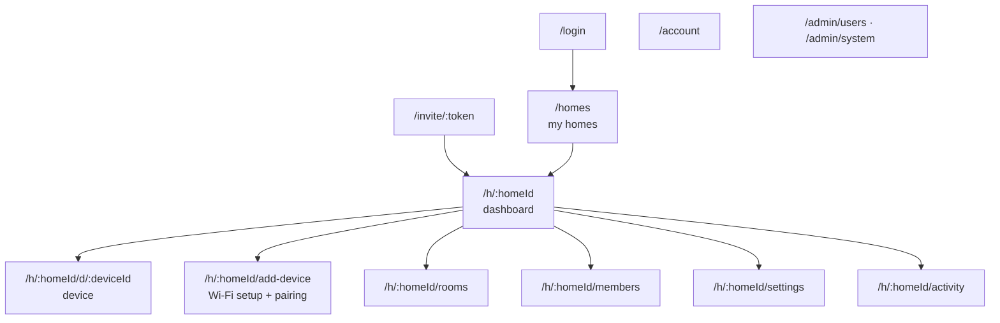
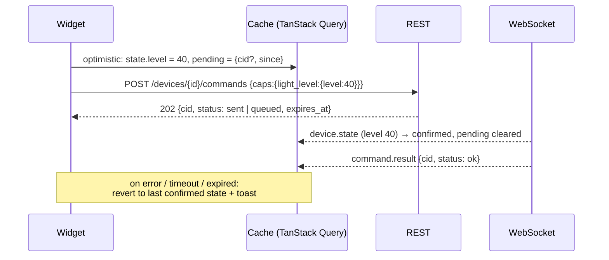
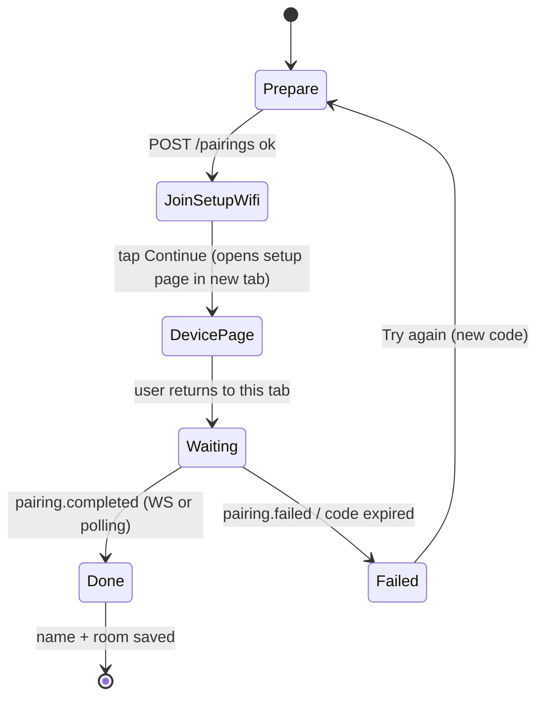

# Web app specification (draft v0.1)

Status: **draft for discussion**. The web app is a single-page app (SPA) that talks only
to the backend described in [server.md](server.md): REST for reading and changing data,
WebSocket for live updates. It never talks to MQTT or to devices directly. The one exception
is opening a device's own setup page during Wi-Fi setup (§9).

Section numbers like "server §6.2" point into [server.md](server.md).

---

## 1. Principles

1. **The server is the source of truth.** The SPA keeps a cache of server data and
   updates it from REST responses and WebSocket events. It never invents state.
2. **UI built from capabilities.** A device page is assembled from the device's capability
   list (server §5.3) through a **widget registry** (§7). Adding a device made of existing
   capability types needs **zero web changes**. An unknown capability type still renders (fallback widget).
3. **Phone first.** People control lamps from the sofa and set up devices standing next to
   them. Every screen works at 360 px width with touch. Desktop gets more columns, not different features.
4. **Instant feel.** Controls react immediately (optimistic updates, §8) and then show the confirmed device state.
5. **Permissions come from the server.** The SPA doesn't re-implement the role table. It reads
   `my_permissions` for each home and shows or hides actions accordingly (§11). The server still checks everything.
6. **No secrets in JavaScript.** The session is an HttpOnly cookie (server §6.1). Nothing goes
   into localStorage except UI preferences (last home, theme).
7. **Works without internet.** On a local server the SPA loads entirely from the home box:
   no CDNs, external fonts or analytics.

## 2. Tech stack (proposed)

| Concern | Choice | Why |
|---|---|---|
| Framework | **React 19 + TypeScript** (decided) | Largest ecosystem; all libraries below are first-class |
| Build | Vite | Fast dev server, static output for Nginx |
| Routing | TanStack Router (or React Router) | Typed routes and params |
| Server data | **TanStack Query** | Caching, refetch, optimistic updates, cache updates from WebSocket |
| API client | `openapi-typescript` + `openapi-fetch` | Types generated from FastAPI's OpenAPI. Backend changes show up as TS errors |
| UI components | Radix primitives + Tailwind (shadcn/ui style) (decided) | Accessible slider, switch, dialog, select; we own the code. Look comes from design tokens (§13.1) |
| Forms | React Hook Form + Zod | Validation; settings forms generated from descriptors |
| Local UI state | Zustand (small) | Connection status, toasts, wizard state |
| i18n | i18next + `Intl` | English (default) and Ukrainian from day one; dates, numbers and plurals via `Intl` |
| Tests | Vitest + Testing Library, Playwright (e2e), **MSW** (mock API) | MSW also lets us build the UI before the backend exists |

## 3. Site map and routes



| Route | Screen | Who sees it |
|---|---|---|
| `/login` | Sign in | everyone (signed out) |
| `/invite/:token` | Accept invitation (sign up if new) | everyone |
| `/` | Redirect: last opened home, or `/homes` | signed in |
| `/homes` | My homes: list, create | signed in |
| `/h/:homeId` | Home dashboard: devices by room, quick controls | members |
| `/h/:homeId/d/:deviceId` | Device: controls, settings, history, info | members (guests: allowlisted devices) |
| `/h/:homeId/add-device` | Add device wizard | `device.pair` |
| `/h/:homeId/rooms` | Manage rooms | `room.manage` |
| `/h/:homeId/members` | Members and invitations | members (actions need `member.manage`) |
| `/h/:homeId/settings` | Home settings: rename, timezone, leave, transfer, delete | members (actions per permission) |
| `/h/:homeId/activity` | Audit log | `audit.view` |
| `/account` | Profile, password, sessions | signed in |
| `/admin/users`, `/admin/system` | Instance admin | `is_admin` |
| `/admin/firmware`, `/admin/rollouts[/:id]` | Firmware catalog and rollouts (§5.13) | `is_admin` |

Navigation: on phones, a bottom bar (**Home** · **Add** · **Members** · **More**) plus a home
switcher in the header. On desktop, a left sidebar with the same items.

## 4. CRUD overview

| Entity | Create | Read | Update | Delete | Screen |
|---|---|---|---|---|---|
| Home | `POST /homes` | `GET /homes`, `GET /homes/{id}` | `PATCH /homes/{id}` (name, timezone) | `DELETE /homes/{id}` (owner, confirm by typing the name) | Homes, Home settings |
| Room | `POST /homes/{id}/rooms` | `GET .../rooms` | `PATCH .../rooms/{roomId}` (name, order) | `DELETE .../rooms/{roomId}` (devices become "No room") | Rooms |
| Device | **pairing wizard** (`POST /homes/{id}/pairings`, §9) | `GET /homes/{id}/devices`, `GET /devices/{id}` | `PATCH /devices/{id}` (name, room, icon) | `DELETE /devices/{id}` (removes + factory reset, §10) | Dashboard, Device |
| Device control | `POST /devices/{id}/commands` | live state via WS | n/a | n/a | Dashboard, Device |
| Device settings | n/a | in device payload | `PUT /devices/{id}/settings` | n/a | Device → Settings |
| Member | invitation (`POST .../invitations`) | `GET .../members` | `PATCH .../members/{userId}` (role, guest allowlist, expiry) | `DELETE .../members/{userId}`, or **Leave home** for yourself | Members |
| Invitation | `POST .../invitations` | `GET .../invitations` | n/a | `DELETE .../invitations/{id}` | Members |
| My account | (by admin / invite) | `GET /me` | `PATCH /me`, `POST /me/password` | n/a | Account |
| Session | login | `GET /me/sessions` | n/a | `DELETE /me/sessions/{id}`, logout | Account |
| User (admin) | `POST /admin/users` | `GET /admin/users` | `PATCH /admin/users/{id}` (disable, admin flag), reset password | `DELETE /admin/users/{id}` | Admin |
| Device firmware update | `POST /devices/{id}/ota` (update now) | `GET /devices/{id}/ota` + WS `ota.progress` | n/a | `DELETE /devices/{id}/ota` (cancel) | Device → Info |
| Home update policy | n/a | in home payload | `PATCH /homes/{id}` (`ota_policy`, `ota_window`) | n/a | Home settings |
| Firmware image (admin) | `POST /admin/firmware` (upload image + manifest) | `GET /admin/firmware` | n/a | `DELETE /admin/firmware/{id}` (if unused) | Admin → Firmware |
| Rollout (admin) | `POST /admin/rollouts` | `GET /admin/rollouts[/{id}]` | start / pause / resume / abort | n/a | Admin → Rollouts |

## 5. Screens

Every screen has four states: **loading** (skeletons, not spinners), **empty** (with a
call to action), **error** (message + retry), and **ready**.

### 5.1 Sign in `/login`
- Email, password, **Sign in**. Errors: wrong credentials (no hint which field), rate limited (show wait time).
- After login: go to `returnTo` (if it's an internal path) or `/`.
- No "sign up" link (no open sign-up, server §6.1). No "forgot password" while there's no
  email delivery. Instead the text says "Ask your server admin to reset your password".

### 5.2 Accept invitation `/invite/:token`
- Shows: home name, who invited, role.
- Signed in: **Join home** → dashboard of that home.
- Signed out: two tabs, **I have an account** (sign in, then join) and **Create account**
  (display name, email prefilled if the invitation has one, password ×2).
- Expired, used or revoked token: a clear message plus "ask for a new invitation".
- The token is removed from the address bar (`history.replaceState`) once the page loads.

### 5.3 My homes `/homes`
- Cards: home name, my role, device count, how many are online.
- **Create home**: name, timezone (default from the browser). I become owner.
- Empty state (new user): "Create your first home" or "Ask someone to invite you".

### 5.4 Home dashboard `/h/:homeId`
The main screen.

```
┌──────────────────────────────────┐
│ ☰  Flat ▾                 ● live │  home switcher, connection dot
├──────────────────────────────────┤
│ [All] [Living] [Bedroom] [No room]│  room filter chips
├──────────────────────────────────┤
│ Living room                      │
│ ┌───────────────┐┌──────────────┐│
│ │ 💡 Desk lamp  ││ 💡 Floor lamp││
│ │ On · 40%  [⏻] ││ Offline 2h   ││  card = name, summary, primary control
│ │ ▬▬▬▬▬○────    ││              ││
│ └───────────────┘└──────────────┘│
│ Bedroom                          │
│ ┌───────────────┐                │
│ │ 🚶 Hall sensor│                │
│ │ Motion 3m ago │                │
│ └───────────────┘                │
├──────────────────────────────────┤
│  Home    ＋ Add    Members  More │
└──────────────────────────────────┘
```

- Data: `GET /homes/{id}` + `GET /homes/{id}/devices` + `GET /homes/{id}/rooms`, then live WS updates.
- Devices grouped by room (rooms in `sort_order`, then "No room"). Filter chips per room.
- **Device card**: icon, name, one-line summary (from widgets' `summarize`), the
  **primary control** (§7.3), online/offline badge. Tap the card body → device page.
  The primary control works directly on the card.
- Offline device: greyed out, "Offline · last seen 2 h ago". Controls still usable:
  commands get queued (server §5.5), and the card shows "Queued" until delivered or expired.
- Empty state: "No devices yet", with **Add device** (if permitted).

### 5.5 Device page `/h/:homeId/d/:deviceId`
Tabs (on desktop, sections side by side):

| Tab | Content |
|---|---|
| **Controls** | Every capability's **Detail** widget, in descriptor order. `system` goes last, collapsed |
| **Settings** | Auto-generated form from all capabilities' `settings` descriptors (§7.4). Shows "Pending, applies when online" if `applied_rev < rev`. Needs `device.settings` |
| **History** | Charts and event lists for capabilities with `history: true` (range: 24 h / 7 d / 30 d). Hidden if none |
| **Info** | Name, room, icon (editable with `device.manage`), model, hw id, signal strength, uptime, added on/by. **Firmware** block (below). Actions: **Identify** (blink), **Restart**, **Remove device** |

**Firmware block** (Info tab), data from `GET /devices/{id}/ota` + WS `ota.progress`:

| Situation | Shows |
|---|---|
| Up to date | "Firmware 0.3.0 · up to date" |
| Update available | "0.4.0 available", release notes (expandable), **Update now** (needs `device.update`) |
| In progress | progress bar with the step: Downloading 35 % → Verifying → "Waiting until the light is off" → Restarting. **Cancel** while downloading or waiting |
| Succeeded | toast "Desk lamp updated to 0.4.0", version updates |
| Rolled back / failed | "Update to 0.4.0 failed, still on 0.3.0" + reason in plain words. No retry button for rollbacks (a fixed version comes from the admin) |

The device card on the dashboard shows a small "Updating…" badge while a job is active,
so an offline-looking device during the reboot doesn't alarm anyone.

### 5.6 Add device `/h/:homeId/add-device`
The wizard in §9.

### 5.7 Rooms `/h/:homeId/rooms`
- List with drag-to-reorder (plus up/down buttons for accessibility), rename inline, delete.
- **Add room**: name.
- Deleting a room with devices: "3 devices will move to No room", then confirm.
- Assigning devices: from the device's Info tab, or a **Move devices** multi-select on this screen.

### 5.8 Members `/h/:homeId/members`
- Member list: name, email, role badge, guest expiry. Me marked "(you)".
- With `member.manage`: change role (owner-only roles disabled for managers), edit guest
  allowlist + expiry, remove. You can't demote or remove the last owner (server returns
  `last_owner`; the UI also disables it).
- **Invite**: role (+ allowlist/expiry for guest), optional email. Result: an invitation
  **link** with **Copy** and **Share** buttons (`navigator.share` on phones, which opens
  WhatsApp/Telegram/etc.). No email sending yet.
- Pending invitations: role, created, expires, **Revoke**.

### 5.9 Home settings `/h/:homeId/settings`
- Rename, timezone (owner).
- **Firmware updates** (`device.update`): **Automatic** or **Ask me first** (`ota_policy`),
  and an install window ("Only between 02:00 and 05:00", in the home's timezone, or "Any time").
  Explanation text: "Devices download updates in the background and restart only when not
  in use (for lamps: when the light is off)."
- **Leave home** (anyone except the last owner).
- **Transfer ownership** (owner → pick a member, confirm).
- **Delete home** (owner): lists what will happen ("4 devices will be removed and factory reset"),
  and the user must type the home name to confirm.

### 5.10 Activity `/h/:homeId/activity`
Audit log list: time, who, what ("Anton removed Desk lamp"). Filter by type and member. Paged (newest first).

### 5.11 Account `/account`
- Display name, email (read-only at first), **Change password** (current + new ×2).
- **Sessions**: device/browser, IP, last active, "this session" marker, **Sign out** per
  session, **Sign out everywhere else**.
- Preferences: theme (system/light/dark), language.
- **Sign out**.

### 5.12 Admin `/admin/users`, `/admin/system`
- Users: list, create (email, name, temporary password **or** one-time setup link), disable/enable,
  make admin, **reset password** (makes a one-time link to give the user), delete.
- System: backend/broker/DB status, version, device counts (online/total), certificate expiry
  dates. No access to homes' devices (server §4).

### 5.13 Admin: firmware and rollouts `/admin/firmware`, `/admin/rollouts`
Implements server §13.

- **Firmware catalog**: table per model (version, channel, size, uploaded, used by N devices).
  **Upload**: pick `zephyr.signed.bin` + `manifest.json`. The server validates both (wrong
  key, mismatched hash or version → clear error). Delete is allowed only if unused.
- **New rollout**: pick firmware → targets (all devices of the model / chosen homes / chosen
  devices, with a count preview) → stages (default `1 device → 10 % → 100 %`) → failure
  threshold → urgent yes/no → **Create** (draft) → **Start**.
- **Rollout page**: stage progress, counts per state (pending, downloading, waiting for idle,
  succeeded, failed, rolled back), the list of failed devices with errors, buttons
  **Pause / Resume / Abort**. Live via polling (5 s) while open.
  The admin sees device hw ids, models and versions here, but **not** home contents (names, rooms, state).

## 6. Data loading and cache

TanStack Query keys:

| Key | Source | Updated by WS |
|---|---|---|
| `['me']` | `GET /me` | n/a |
| `['homes']` | `GET /homes` | `home.updated`, `member.changed` → refetch |
| `['home', homeId]` | `GET /homes/{id}` (incl. `my_role`, `my_permissions`) | `home.updated` |
| `['devices', homeId]` | `GET /homes/{id}/devices` | `device.*` events patch the cache in place |
| `['rooms', homeId]` | `GET /homes/{id}/rooms` | refetch on `home.updated` |
| `['members', homeId]` | `GET /homes/{id}/members` | `member.changed` |
| `['history', deviceId, cap, range]` | `GET /devices/{id}/history` | not live (refetch on open) |

- `['devices', homeId]` is **one list** for the whole home. The device page reads from the
  same cache, so the dashboard and device page always agree.
- Stale time: 30 s for lists, but live data comes from WS anyway. Refetch on window focus.

## 7. Capability widgets

### 7.1 Registry

```ts
// web/src/capabilities/registry.ts
interface WidgetProps<Desc, State> {
  device: Device;              // id, name, online, ...
  cap: Desc;                   // this capability's descriptor (server §5.3)
  state: State | undefined;    // this capability's current state
  pending: PendingCommand | undefined;  // optimistic / queued info (§8)
  canControl: boolean;         // permission AND not readonly
  send: (payload: unknown, opts?: { ttl?: number }) => void;  // POST /commands
  action: (name: string) => void;       // POST /commands with action
}

interface CapabilityWidget<Desc = any, State = any> {
  type: string;                                   // "brightness"
  Card?: React.FC<WidgetProps<Desc, State>>;      // compact control for the dashboard card
  Detail: React.FC<WidgetProps<Desc, State>>;     // full control on the device page
  summarize?: (cap: Desc, state: State) => string;// "40%", "On", "Motion 3 min ago"
  icon?: IconName;
}

export const registry: Record<string, CapabilityWidget> = { switch, brightness, timer, motion, system };
export const fallback: CapabilityWidget = /* read-only key/value view of state */;
```

Adding a capability type to the web = one folder in `web/src/capabilities/<type>/` plus one registry line.

### 7.2 First widgets

| Type | Card | Detail | State → UI | Commands |
|---|---|---|---|---|
| `switch` | toggle button ⏻ | big toggle | `on` | `{on: bool}` |
| `brightness` | thin slider | large slider + % label + −/＋ buttons | `level` (min..max from descriptor) | `{level: n}` while dragging, throttled (§8.2) |
| `timer` | "⏱ 12 min" badge when running | preset chips (from `presets`) + **Cancel** + live countdown | `remaining_min` | `{minutes: n}` (0 = cancel) |
| `motion` | "Motion now" / "3 min ago" | status, last detected, today's count; link to History | `detected`, `last_ts` | none (readonly) |
| `system` | n/a | firmware, uptime, signal (bars from RSSI), heap; buttons **Identify**, **Restart**, **Factory reset** (danger zone) | `uptime_s`, `rssi`, … | actions from `actions` list |
| *unknown* | n/a | "Unsupported control (type `x`)" + read-only state table | anything | none |

Related capabilities on the same device: if a device has both `switch` and `brightness`,
the card shows the toggle **and** the slider in one row. The rule is generic ("switch + brightness
→ combined light card") and lives in the registry, not per device model.

### 7.3 Primary control on cards

The card shows the **first controllable capability** in descriptor order (plus the
switch+brightness combination above). If nothing is controllable (pure sensor), it shows
the first `summarize` text. Firmware therefore orders its capabilities with the main one first.
No special flag is needed in the descriptor.

### 7.4 Settings form (generated)

From each capability's `settings` (server §5.3), one section per capability:

| Descriptor | Field |
|---|---|
| `integer` with `min`/`max`, range ≤ 100 | slider + number input |
| `integer` larger range | number input with unit (from name suffix: `_ms`, `_s`, `_min`) |
| `boolean` | switch |
| `enum` | select (or segmented control if ≤ 4 options) |
| `default` | "Reset to default" link per field |

One **Save** button for the whole form → `PUT /devices/{id}/settings` with only changed values.
Labels come from i18n keys `cap.<type>.settings.<name>`, falling back to a humanized name
(`hold_s` → "Hold (s)").

## 8. Commands and live state

### 8.1 Flow



- **Optimistic:** the widget shows the new value at once with a subtle "pending" style.
- **Confirmed:** when `device.state` arrives with the value (or `command.result ok`).
- **Queued** (device offline): the card shows "Queued · applies when online (45 s)". On
  `command.result expired`, revert and toast "Desk lamp was offline, the change wasn't applied".
- **Error / timeout:** revert to the last confirmed state, toast with the error message.
- **Local changes win when they're newer:** if someone turns the knob on the lamp, the
  `device.state` from WS updates the UI, except while the user is touching that same control (§8.2).

### 8.2 Sliders

- While dragging: send at most every **250 ms** (throttle). Always send the **final value on release**.
- While the user's finger is down, ignore incoming `device.state` for that capability (no
  "jumping" thumb). Apply the latest received state on release if no command is pending.
- The server coalesces queued commands per capability (server §5.5), so throttling is about network traffic only.

### 8.3 WebSocket client

- One connection per browser tab, opened after login (`/api/v1/ws`, cookie auth).
- Subscribes to the **current home**. Switching homes = `unsubscribe` + `subscribe`.
- Reconnect with backoff 1 s → 2 → 5 → 10 → 30 s (with jitter). After reconnecting:
  refetch `['devices', homeId]` to catch up, then apply events again.
- Connection indicator in the header: ● live / ◌ reconnecting / ○ offline. After 10 s
  disconnected, show a banner "Live updates paused, reconnecting…".
- `ping` every 25 s. If no `pong` within 10 s, reconnect.
- Event → cache mapping:

| WS event | Cache update |
|---|---|
| `device.state` | patch `devices[homeId][id].state` (merge per capability) |
| `device.availability` | patch `online`, `last_seen_at` |
| `device.event` | toast for important events (later: notifications); History tab refetch if open |
| `device.updated` | replace device object |
| `device.added` / `device.removed` | insert / remove in list (+ toast) |
| `command.result` | resolve pending command (§8.1) |
| `pairing.completed` / `pairing.failed` | wizard step (§9) |
| `ota.progress` | update the device's firmware block and card badge; toast on succeeded / failed / rolled back |
| `home.updated` / `member.changed` | invalidate `['home']`, `['homes']`, `['members']`. If I lost access → leave to `/homes` with a message |

## 9. Add device wizard

Implements server §7.1 (SoftAP + QR) and §7.2 (pairing). The web app's job is to guide the
user and to pass the pairing code to the device's setup page **inside a link**, so nobody types it.



| Step | Screen content |
|---|---|
| **1. Prepare** | "Plug in the device. A new device starts setup mode automatically: the light breathes slowly. Not breathing? Hold the button for 10 s." Button **Start**, which calls `POST /homes/{id}/pairings` → `{pairing_id, code, broker_host, expires_at}` |
| **2. Join the device's Wi-Fi** | "Scan the QR sticker on the device with your phone camera and tap **Join**." Illustration of the sticker. Fallback text: "Or open Wi-Fi settings and join **OlaHome-XXXX** with the password on the sticker." The code is shown large ("K7Q4-M2XP") for the captive-portal path. Expiry countdown (10 min) |
| **3. Continue** | Button **Continue → device setup** opens `http://192.168.4.1/setup#code=<code>&broker=<broker_host>` in a **new tab**. Small print: "If your phone already opened a setup page by itself, use it and enter the code above." |
| **4. Waiting** | "Finish setup on the device page, then come back here." Spinner. This tab polls `GET /pairings/{id}` every 3 s (WebSocket may be down while the phone is on the device's Wi-Fi) and listens for `pairing.completed` |
| **5. Done** | "Desk lamp added 🎉". Name field (default: model name), room select, **Save** → `PATCH /devices/{id}` → device page |
| **Failed** | Message from the error (`code_expired`, `invalid_code`, `already_claimed` = "This device belongs to another home. Its owner must remove it first."). **Try again** |

Notes:
- The new tab is on `http://` (the device has no certificate). The browser allows opening
  a plain-HTTP link from our HTTPS page as a navigation. Our page doesn't fetch from the device itself (that would be blocked).
- While the phone is on `OlaHome-XXXX` it has no internet, so this tab can't reach the
  server. That's expected. Polling resumes when the phone returns to home Wi-Fi.
- **Cancel** at any step → `DELETE /pairings/{id}`.
- On desktop (laptop can join Wi-Fi too) the same flow works. The QR step says "Join Wi-Fi **OlaHome-XXXX**" instead.

## 10. Destructive actions

| Action | Confirmation |
|---|---|
| Remove device | Dialog: "Remove Desk lamp? It will be reset to factory settings and must be set up again." **Remove** (red) |
| Factory reset (system widget) | Same as remove (the server removes the device too) |
| Restart device | Simple confirm |
| Delete room | Says how many devices move to "No room" |
| Remove member / revoke invitation | Simple confirm |
| Leave home | Confirm. If I'm the last owner: blocked with "Transfer ownership first" |
| Delete home | Lists consequences + type the home name to enable **Delete** |
| Sign out everywhere | Simple confirm |

After the server confirms, show a toast. No undo (not supported by the server).

## 11. Permissions in the UI

The server returns, per home, `my_role` and `my_permissions` (server §6.2 addition):

```json
{ "id": "...", "name": "Flat", "my_role": "manager",
  "my_permissions": ["device.control", "device.manage", "device.settings", "device.pair", "device.update",
                     "room.manage", "member.manage", "audit.view", "history.view"] }
```

- `can('device.pair')` helper. Hide management actions the user can't do. Don't show disabled
  buttons with no explanation. Where a disabled control is clearer (e.g. a guest viewing a
  device), add a tooltip ("Only managers can change settings").
- Guests: the server returns only allowlisted devices, so the UI needs no extra filtering.
- Route guards: a URL the user can't access shows "Not found" (matches the server's 404 rule).

## 12. Errors and feedback

- Every API error has `{error: {code, message}}` (server §6.4). The UI maps `code` to an
  i18n message. Unknown codes show the server's `message`.
- `401` anywhere → clear cache, go to `/login?returnTo=<current>`.
- `403` → toast "You don't have permission". `404` → "Not found" page with a link home.
- `409 device_offline` (non-queueable actions like restart) → toast "Device is offline".
- `429` → toast "Too many attempts, wait N s".
- Network down → global banner "Can't reach the server", with retries handled by TanStack Query.
- Toasts: 4 s, stack max 3, errors stay until dismissed.

## 13. Look and feel, accessibility

- Mobile first. Breakpoints: < 640 phone (1 column cards), 640–1024 tablet (2–3), > 1024 desktop (sidebar + 4).
- Touch targets ≥ 44 px. The slider thumb is large enough to drag without zooming.
- Light and dark theme (follows the system, can be overridden).
- Keyboard: everything reachable with Tab. Sliders work with arrows/PageUp/PageDown.
  Radix components provide the ARIA roles.
- Color is never the only signal (offline = grey **and** text "Offline").
- Device icons: a small built-in set (lamp, bulb, strip, sensor, plug, …). The device's `type`
  suggests a default, and the user can change it.
- PWA: web manifest + icons, so "Add to Home Screen" gives an app-like icon on iPhone and Android.
  No offline mode beyond the app shell (controlling devices needs the server anyway).

### 13.1 Design tokens (mockups come later)

Design mockups will come later, so the first UI uses neutral shadcn/ui defaults, built so
the look can change **without touching components**:

- All colors, radii, spacing, shadows and fonts are **CSS variables** (`--color-primary`,
  `--radius-card`, …) defined in one file (`src/styles/tokens.css`), with light and dark sets.
  Tailwind's theme maps to these variables. Components use only token classes (`bg-primary`),
  never raw colors (`bg-blue-500`). Lint enforces this.
- Components live in `components/ui/` (our own copies of shadcn/ui), so restyling to the
  mockups means editing tokens first and these components second. Feature screens don't change.
- Fonts are self-hosted (no Google Fonts requests), with a font that has Cyrillic for Ukrainian.

### 13.2 Languages

- English (`en`, default) and Ukrainian (`uk`) ship from the start: `src/i18n/en.json`, `uk.json`.
- Language: the user's choice in Account, else the browser language if supported, else English.
  Stored per user on the server (`PATCH /me {locale}`) so it follows the user across devices.
- No hardcoded strings in components (lint rule). Keys are grouped by feature
  (`dashboard.empty.title`, `cap.brightness.settings.fade_ms`).
- Plurals via i18next/ICU (Ukrainian has 3 plural forms: 1 пристрій, 2 пристрої, 5 пристроїв).
  Dates, times and "3 min ago" via `Intl.DateTimeFormat` / `Intl.RelativeTimeFormat` in the
  active locale, in the **home's timezone** for schedules and history.
- Device names, room names and home names are user text and are never translated.
- Server error messages: the UI translates by `error.code`. The server's English `message` is only a fallback.
- CI check: every key in `en.json` exists in `uk.json`.

## 14. Security

- Session cookie only, with no token handling in JS. Every state-changing request adds
  `X-Requested-With: ola-home` (server §6.1). The API client does this in one place.
- **Content-Security-Policy** (set by Nginx): `default-src 'self'; connect-src 'self';
  img-src 'self' data:; style-src 'self'; script-src 'self'; frame-ancestors 'none'`.
  This works because there are no external scripts or fonts.
- Never render HTML from data (`dangerouslySetInnerHTML` is banned by lint). Device names,
  room names and member names are user input and get escaped by React.
- `Referrer-Policy: no-referrer` (invitation tokens in URLs must not leak).
- `returnTo` accepts only internal paths starting with `/` (no open redirect).
- Dependencies: lockfile committed, `npm audit` in CI, Renovate/Dependabot.

## 15. Project structure

```
web/
├── index.html, vite.config.ts, package.json, tsconfig.json
├── public/                    # icons, manifest.webmanifest
└── src/
    ├── main.tsx, app/         # router, providers (QueryClient, i18n, theme), layout, nav
    ├── api/
    │   ├── schema.d.ts        # generated from backend OpenAPI (npm run gen:api)
    │   ├── client.ts          # openapi-fetch + CSRF header + 401 handling
    │   └── ws.ts              # WebSocket client (§8.3)
    ├── features/
    │   ├── auth/              # login, invite accept, account, sessions
    │   ├── homes/             # homes list, home settings
    │   ├── dashboard/         # dashboard, device cards
    │   ├── devices/           # device page, info, remove
    │   ├── pairing/           # add device wizard
    │   ├── rooms/
    │   ├── members/           # members, invitations
    │   ├── activity/
    │   ├── ota/               # device firmware block, home update policy
    │   └── admin/             # users, system, firmware catalog, rollouts
    ├── capabilities/          # widget registry (§7)
    │   ├── registry.ts
    │   ├── switch/ brightness/ timer/ motion/ system/ _fallback/
    │   └── settings-form/     # generated settings form (§7.4)
    ├── components/ui/         # buttons, dialogs, slider, toast (Radix + Tailwind)
    ├── lib/                   # can(), formatters (time ago, RSSI bars), hooks
    ├── styles/tokens.css      # design tokens (§13.1)
    ├── i18n/                  # en.json, uk.json
    └── mocks/                 # MSW handlers + fake devices for dev without backend
```

## 16. Build, dev and deploy

- `npm run dev`: Vite dev server, proxying `/api` (incl. WebSocket) to the backend.
- `npm run dev:mock`: no backend needed. MSW serves fake homes and devices, and a fake WS
  emits state changes. **This lets the UI be built before the backend.**
- `npm run gen:api`: regenerate `schema.d.ts` from the backend's `/openapi.json`. CI fails if it's stale.
- `npm run build` → `web/dist/`, copied into the Nginx container (`deploy/nginx/`) which serves
  the SPA (fallback to `index.html` for client routes) and proxies `/api` and `/api/v1/ws` to the backend.
- No build-time configuration: same origin, so the API base is always `/api/v1`.
- CI: typecheck, lint, unit tests, build, Playwright e2e against the mock API.

## 17. Scope: MVP and later

**MVP** (implementation order step 7):
- Sign in/out, account (password, sessions)
- Homes: list, create, rename, delete, leave
- Dashboard with cards, live updates, room filter
- Device page: Controls, Info (rename, room, icon, identify, restart, remove), Settings
- Widgets: switch, brightness, timer, system, fallback (motion when such a device exists)
- Add device wizard
- Rooms CRUD
- Members: list, invite link, roles, remove; accept invitation
- Admin: users list/create/disable/reset password

**With OTA (implementation order step 8):** device firmware block, home update policy,
admin firmware catalog and rollouts.

**Later:** History tab and charts, Activity (audit) screen, admin system page, guest
allowlist UI, transfer ownership, scenes, schedules, automations, notifications, restyling to
the design mockups, more languages.

MVP includes both English and Ukrainian.

## 18. Decisions

| # | Topic | Status | Proposal |
|---|---|---|---|
| 1 | Framework | **decided** | React 19 + TypeScript (stack in §2) |
| 2 | Component styling | **decided** | Tailwind + Radix (shadcn/ui pattern). Visual design comes later from mockups (§13.1) |
| 3 | Languages | **decided** | English (default) and Ukrainian (`uk`) from the start, i18n-ready for more |
| 4 | Server API additions found while writing this spec | **added to server.md** | `my_role` + `my_permissions` on homes; pairing response with `broker_host`; invitation accept for new users; leave home; transfer ownership; admin password-reset link; room `sort_order` update |
