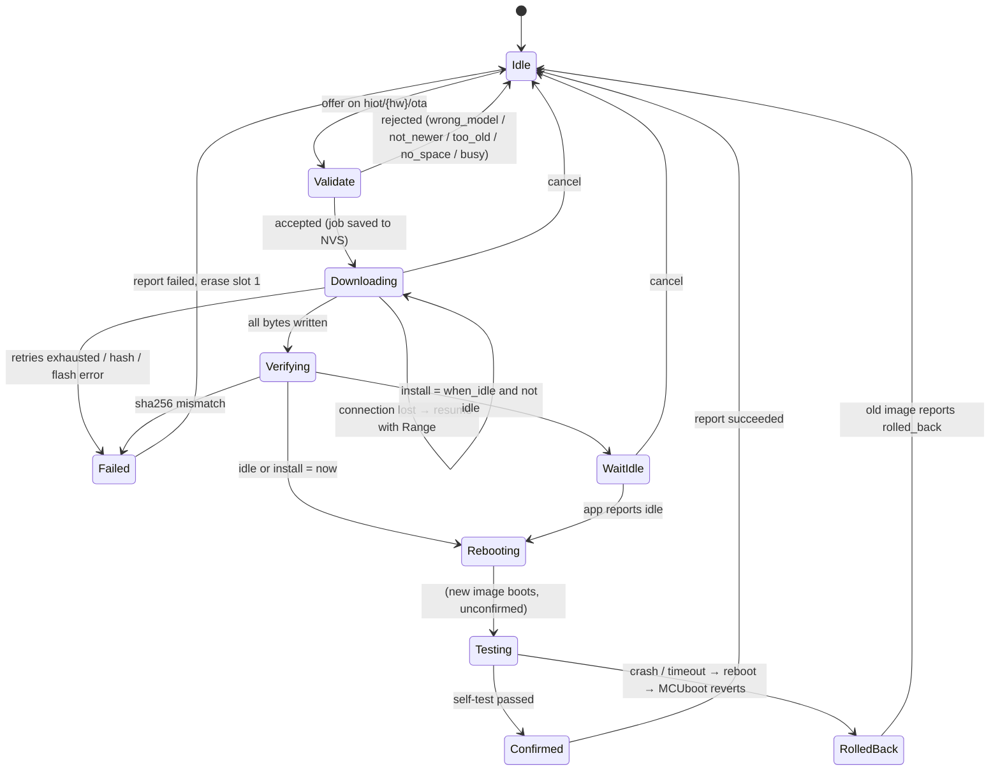

# hiot_ota: firmware updates over the air (firmware spec, draft v0.1)

Device side of [docs/spec/server.md §13](../../../docs/spec/server.md) (catalog, rollouts,
MQTT messages, signed download URLs). Read that first. This file says **how the firmware
implements it**.

Status: spec only, not implemented (implementation order step 8). Items marked
**⚠ verify** must be confirmed against the pinned Zephyr/MCUboot version or on hardware.

---

## 1. Summary

- **MQTT** brings the offer (`hiot/{hw}/ota`) and carries progress (`hiot/{hw}/ota/status`).
- **HTTPS** downloads the image into **slot 1** while the device keeps working.
- **MCUboot** checks the signature, swaps the images and boots the new one in **test** mode.
- The new firmware **self-tests** and confirms itself. If it doesn't, the next reboot
  **rolls back** to the old image automatically.
- Settings, Wi-Fi and credentials (NVS) are untouched. The lamp comes back at the same brightness.

## 2. Flash layout (ESP32-C3, 4 MB)

```
0x000000 ┌───────────────────┐
         │ MCUboot           │  bootloader, never updated over the air
         ├───────────────────┤
         │ slot 0 (primary)  │  running image
         ├───────────────────┤
         │ slot 1 (secondary)│  download target
         ├───────────────────┤
         │ storage (NVS)     │  settings, Wi-Fi, credentials, OTA job record
0x400000 └───────────────────┘
```

Partitions come from the board devicetree (`boot_partition`, `slot0_partition`,
`slot1_partition`, `storage_partition`). **⚠ verify** the exact sizes in the pinned
Zephyr's `esp32c3_supermini` DTS, and check that a full image (Wi-Fi + TLS + HTTP + MQTT)
fits a slot with ≥ 20 % headroom. If not, override partitions in the app overlay.

## 3. MCUboot configuration (sysbuild)

| Setting | Value | Why |
|---|---|---|
| `SB_CONFIG_BOOTLOADER_MCUBOOT` | `y` | already on in `apps/lamp/sysbuild.conf` |
| Signature type | ECDSA P-256 (`SB_CONFIG_BOOT_SIGNATURE_TYPE_ECDSA_P256`) | same algorithm family as our TLS, small and fast |
| Signing key | `SB_CONFIG_BOOT_SIGNATURE_KEY_FILE` = dev key locally, release key in CI | server spec §13.7. **Never** MCUboot's sample key |
| Upgrade mode | a **swap** mode (swap-using-move or swap-using-scratch) | swap keeps the old image so a failed update can roll back. Overwrite-only can't |
| Downgrade prevention | on, if the ESP32 port supports it | MCUboot rejects lower versions too |

**⚠ verify:** which swap modes the Espressif MCUboot port supports in our Zephyr version.
If only overwrite-only exists, rollback is impossible, and we'd need a different approach
(e.g. keep a "factory" recovery image). This is the most important thing to check first.

## 4. Device state machine



### 4.1 Validate (on offer)

Reject with an error if any check fails:

| Check | Error |
|---|---|
| Offer's model must equal our `model` (implied: server only offers matching images, but check the image header too) | `wrong_model` |
| `version` > running version (semver compare) | `not_newer` |
| running version ≥ `min_from_version` (if given) | `too_old` |
| `size` ≤ slot 1 size | `no_space` |
| no other job in progress (same job id → resume, not reject) | `busy` |
| URL is `https://` and its host is allowed (same host as the broker or the configured update host) | `download_failed` |

On accept: save `{job, version, sha256, size, url}` to NVS key `hiot/ota/job`, then publish `accepted`.

### 4.2 Downloading

- Zephyr HTTP client over a TLS socket. Same trusted roots as MQTT (our CA + ISRG).
- Stream into slot 1 with the `flash_img` API (`flash_img_init`, `flash_img_buffered_write`).
  Erase progressively while writing (`CONFIG_IMG_ERASE_PROGRESSIVELY`) so there's no long
  pause before the first byte.
- Compute SHA-256 on the fly. After a reboot mid-download, re-hash the bytes already in slot 1.
- **Resume:** send `Range: bytes=<written>-` and continue. Retry with backoff (5 s, 30 s,
  2 min, 10 min, 30 min). After the last retry → `failed: download_failed`.
- HTTP `403` / `410` (URL expired) → `failed: url_expired`. The server sends a fresh offer with a new URL.
- Progress to `ota/status` at least every 10 % or every 5 s, whichever comes later
  (not more often, to keep MQTT quiet).
- The device **keeps working**: capabilities, local input and MQTT state reporting continue.
  The download runs in its own thread with lower priority than input handling.

### 4.3 Verifying

`flash_img_check()` against the offer's SHA-256 and `size`. A mismatch → erase slot 1 → `failed: hash_mismatch`.
The **signature** is not checked here. MCUboot checks it at boot, which is the check that matters.

### 4.4 Waiting for idle

- `install = now` → reboot immediately.
- `install = when_idle` → ask the app: `bool hiot_ota_app_is_idle(void)`, a weak function the app overrides.
  Lamp: idle = light off and no input for 2 min. Default (no override) = always idle.
- Re-check every 30 s. Report `waiting_idle` once. If not idle within 24 h → reboot anyway
  at the next moment the light is off, or at 03:00 local time (SNTP + home timezone come later; until then 24 h fallback).

### 4.5 Rebooting

1. Save state the user would notice: the lamp's capabilities persist their state (on/off, level)
   to NVS so the lamp restores it after boot. This is also what happens after a power cut
   (see `power_on_behavior` setting below).
2. Publish `rebooting`, flush MQTT.
3. `boot_request_upgrade(BOOT_UPGRADE_TEST)` → `sys_reboot()`.

### 4.6 Testing and confirming (new image)

On boot, if `boot_is_img_confirmed()` is false, we are a **new image on trial**:

1. Start a **2 min** self-test timer and a hardware watchdog (`CONFIG_WATCHDOG`, timeout ~30 s,
   fed by the main loop).
2. Pass = Wi-Fi connected **and** MQTT connected with our credentials **and** `config` published.
3. Pass → `boot_write_img_confirmed()` → publish `succeeded` with the new version → clear
   `hiot/ota/job` → erase nothing (slot 1 now holds the old image, kept until the next update).
4. Fail (timer expires, or crash/hang → watchdog reset) → `sys_reboot()` without confirming →
   MCUboot swaps back → the old image boots.

**Exception:** if the home Wi-Fi or the server is down during the test, the new image would
be rolled back even though it's fine. To avoid that, the self-test is extended up to **30 min**
while Wi-Fi is unreachable (the device keeps retrying). It fails only on crash/hang or after 30 min.

### 4.7 Rolled back (old image)

On boot, the old image finds `hiot/ota/job` in NVS with a target version different from
its own running version → the update failed → publish `rolled_back` (with its own version,
`error: not_confirmed`, or `invalid_image` if MCUboot refused the signature) → clear the job.

## 5. Settings that affect updates

Added to the `system` capability (server spec §5.3), so they appear in the web app's settings form:

| Setting | Default | Meaning |
|---|---|---|
| `power_on_behavior` | `restore` | after reboot/power cut: `restore` last state, `off`, or `on` at the last level |

(Install mode and windows are home policies on the server, server spec §13.3, not device settings.)

## 6. Module layout and API

```
firmware/lib/hiot_ota/
├── README.md         # this spec
├── CMakeLists.txt, Kconfig
├── ota.c             # state machine, MQTT offer/status handling, NVS job record
├── download.c        # HTTPS client, Range resume, flash_img streaming, sha256
└── confirm.c         # boot-time trial detection, self-test, confirm / rollback report
```

```c
/* include/hiot/ota.h */
int  hiot_ota_init(void);                 /* call early: handles trial boot / rollback report */
void hiot_ota_on_offer(const char *json, size_t len);   /* called by hiot_net for hiot/{hw}/ota */
void hiot_ota_self_test_passed(void);     /* called by hiot_net after config is published */

/* App hook (weak default: always idle). */
bool hiot_ota_app_is_idle(void);

enum hiot_ota_state { /* IDLE, DOWNLOADING, VERIFYING, WAIT_IDLE, REBOOTING, TESTING */ };
ZBUS_CHAN_DECLARE(hiot_ota_state_chan);   /* apps may show "updating" (lamp: no effect by default) */
```

`hiot_net` owns the MQTT connection. `hiot_ota` gets offers through `hiot_ota_on_offer()`
and publishes status through `hiot_net`'s publish API.

## 7. Kconfig

Ours:

| Option | Default | Meaning |
|---|---|---|
| `CONFIG_HIOT_OTA` | n | enable OTA |
| `CONFIG_HIOT_OTA_SELF_TEST_S` | 120 | self-test time when network is fine |
| `CONFIG_HIOT_OTA_SELF_TEST_MAX_S` | 1800 | max self-test time while Wi-Fi/broker unreachable |
| `CONFIG_HIOT_OTA_IDLE_MAX_H` | 24 | max wait for idle before forcing install |
| `CONFIG_HIOT_OTA_HTTP_BUF` | 2048 | HTTP receive buffer |

Zephyr (names to **⚠ verify**): `BOOTLOADER_MCUBOOT`, `MCUBOOT_IMG_MANAGER`, `IMG_MANAGER`,
`FLASH`, `FLASH_MAP`, `STREAM_FLASH`, `IMG_ERASE_PROGRESSIVELY`, `HTTP_CLIENT`,
`NET_SOCKETS_SOCKOPT_TLS`, `MBEDTLS` (+ SHA-256), `WATCHDOG`, `REBOOT`.

## 8. Memory

During a download the device holds **two TLS sessions** (MQTT + HTTPS), about 30–40 KB extra
RAM. Measure with `ram_report`. If it doesn't fit: publish `downloading`, disconnect MQTT
cleanly during the download (the server shows "updating" instead of "offline" because a job is active), and reconnect after.

## 9. Security

- The image signature is checked by **MCUboot** before the new image ever runs. A compromised
  server or network can't install unsigned code.
- SHA-256 check before reboot catches corrupted downloads early (no wasted reboot).
- No downgrades (device check + MCUboot downgrade prevention if available).
- HTTPS only, the same CA pinning as MQTT, and the URL host must be the broker host or the configured update host.
- The offer topic is writable only by the backend (broker ACL). The device's own account can't write
  other devices' topics.

## 10. Test plan

Automated (`native_sim` / ztest): semver compare, offer validation, state machine with mocked
HTTP/flash, Range resume offsets, NVS job record handling.

On hardware:
- [ ] Happy path, `install: now`
- [ ] `when_idle`: lamp on → waits; turn light off → installs within 30 s + 2 min idle
- [ ] Wi-Fi drop at 50 % → resumes from 50 %, not from 0
- [ ] Power cut during download → resumes after boot
- [ ] Power cut during the swap → MCUboot finishes or reverts, device boots either way
- [ ] Corrupted file on server → `hash_mismatch`, no reboot
- [ ] Image signed with the wrong key → MCUboot refuses → `rolled_back` / `invalid_image`
- [ ] New image that never connects (bad build) → rolled back within the self-test window
- [ ] New image crashes at boot → watchdog → rolled back
- [ ] Router off during self-test → no false rollback (extended self-test)
- [ ] Offer with lower version → `not_newer`
- [ ] Expired URL → `url_expired`, new offer works
- [ ] Lamp brightness after update = before update
