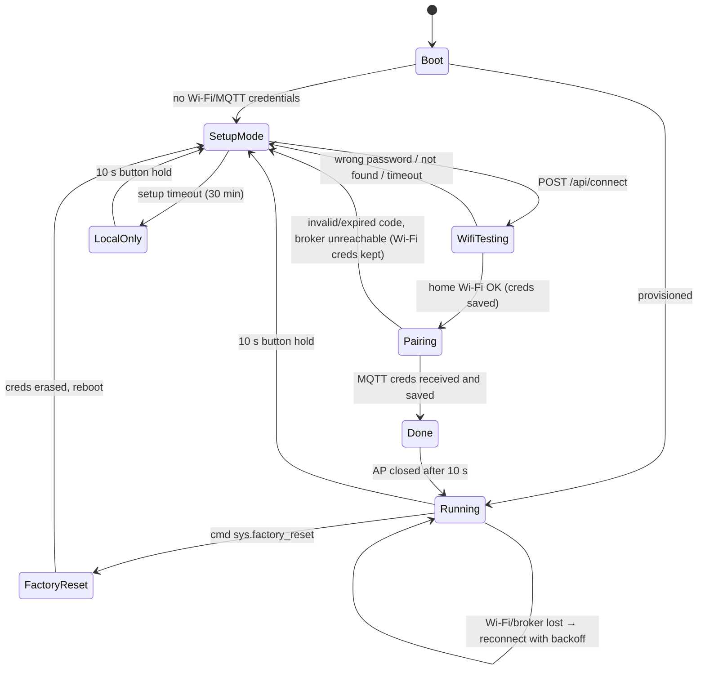

# hiot_provision: Wi-Fi setup and pairing (firmware spec, draft v0.1)

How a device goes from "just unboxed" to "connected and paired with the server".
This is the firmware side of [docs/spec/server.md §7](../../../docs/spec/server.md)
(user flow, pairing with the backend). Read that first. This file says **how the
firmware implements it**.

Status: spec only, not implemented (implementation order step 8). Items marked
**⚠ verify** must be confirmed on real ESP32-C3 hardware or in Zephyr's docs before relying on them.

---

## 1. Summary

- No app, no Bluetooth. The device opens its **own Wi-Fi access point (SoftAP)**,
  protected by a **random per-device setup password** printed as a **QR sticker**.
- The phone joins that network (by scanning the QR) and opens a **setup page served
  by the device**. The pairing code and broker address arrive in the page link from the web app.
- The device tests the home Wi-Fi, then **pairs with the server over MQTT/TLS**
  (one-time code → permanent per-device credentials), then closes its access point.
- The lamp keeps working locally the whole time (encoder, button, timer).

## 2. Data stored on the device

Zephyr settings subsystem on NVS (`CONFIG_SETTINGS_NVS`). All keys live under `hiot/`.

| Key | Written by | Erased by factory reset | Content |
|---|---|:-:|---|
| `hiot/setup/pass` | flashing tool, **once** (§9) | **no** (it's on the sticker) | 12-char setup AP password |
| `hiot/wifi/ssid` | setup (§5) | yes | home Wi-Fi SSID (1–32 bytes) |
| `hiot/wifi/psk` | setup | yes | home Wi-Fi password (empty = open network) |
| `hiot/mqtt/host` | setup | yes | broker `host:port`, e.g. `ola.lan:8883` |
| `hiot/mqtt/user` | pairing (§6) | yes | permanent MQTT username (= hw id) |
| `hiot/mqtt/pass` | pairing | yes | permanent MQTT password |

- "Provisioned" = Wi-Fi **and** MQTT credentials present.
- The pairing code is **never** stored in flash, only in RAM until pairing ends.
- Secrets are never logged (log `ssid` only, never `psk` or passwords).
- NVS isn't encrypted on the ESP32-C3 by default. A real product should enable flash
  encryption + secure boot. Out of scope for now, but the key layout doesn't need to change for it.

## 3. State machine



Rules:
- Setup mode starts **only** when there are no credentials, on a **10 s button hold**,
  or after a **factory reset**. Losing Wi-Fi (router reboot, outage) **never**
  opens the setup AP. The device just keeps retrying (backoff 1 s → 5 min) and works locally.
- Setup mode lasts **30 min** (Kconfig), then the AP closes (`LocalOnly`) to save power and
  limit exposure. Another 10 s hold reopens it.
- A 10 s hold on a provisioned device enters setup mode **without** erasing the old
  credentials. They are replaced only when a new setup succeeds. That way a mistaken hold
  isn't destructive: the device returns to `Running` with the old credentials when setup times out.
- The AP stays up during `WifiTesting` and `Pairing`, so the setup page can show live
  progress and errors. It closes 10 s after `Done`.

## 4. Setup access point

| Item | Value |
|---|---|
| SSID | `OlaHome-XXXX`, where `XXXX` = last 4 hex chars of the hw id (prefix in Kconfig) |
| Security | WPA2-PSK, password = `hiot/setup/pass` |
| Device IP | `192.168.4.1/24` (static on the AP interface) |
| DHCP | Zephyr DHCPv4 server, pool `192.168.4.2`–`.10` (see note) |
| DNS | own tiny UDP responder on port 53: every A query → `192.168.4.1` |
| HTTP | Zephyr HTTP server on port 80 |
| Max clients | 2 |

Note on DHCP: hand out `192.168.4.1` as router **and** DNS. Phones then send their
connectivity checks to us, and that's what triggers the captive-portal pop-up.

AP + STA at the same time: the device must scan networks and test the home Wi-Fi
while the AP is still up. **⚠ verify** that the Zephyr ESP32 Wi-Fi driver supports
AP+STA concurrently on the C3 (look for an `ESP32_WIFI_AP_STA_MODE`-style Kconfig option and the
SAP/STA interface helpers). The radio has one channel: when the STA joins the home router,
the AP **moves to the router's channel** and the phone may drop for a moment. The setup
page must survive that (it retries `/api/status`), and the web app also gets the final result over WebSocket.

## 5. Setup page and local HTTP API

Served only in setup mode. Static page embedded in firmware, gzipped, target **< 20 KB**
(plain HTML + small vanilla JS, no frameworks, no external requests since the phone has no internet).
Embed with Zephyr's `generate_inc_file_for_target(... --gzip)`.

### Page link from the web app

```
http://192.168.4.1/setup#code=K7Q4M2XP&broker=ola.lan:8883
```

The values are in the **fragment** (`#...`). Browsers don't send the fragment to the
server, so they never show up in request logs. The page's JS reads `location.hash` and fills hidden
fields. Opened without a fragment (e.g. from the captive-portal pop-up), the page shows a
**code** field the user types (8 chars, shown in the web app) and uses the broker default
`CONFIG_HIOT_PROV_DEFAULT_BROKER`, if set.

### Endpoints

| Method | Path | Purpose |
|---|---|---|
| `GET` | `/`, `/setup` | Setup page |
| `GET` | `/api/info` | `{hw_id, model, fw, setup_remaining_s}` |
| `GET` | `/api/scan` | `[{ssid, rssi, secure}]`, strongest first, deduplicated, cached 10 s |
| `POST` | `/api/connect` | `{ssid, psk, code, broker}` → `202`, starts `WifiTesting` |
| `GET` | `/api/status` | `{state, error}` (page polls every 1 s) |

`state`: `setup` · `wifi_testing` · `wifi_failed` · `pairing` · `pair_failed` · `done`.
`error` examples: `wrong_password`, `ssid_not_found`, `no_ip`, `broker_unreachable`,
`tls_failed`, `invalid_code`, `code_expired`, `already_claimed`, `timeout`.

Validation on `/api/connect`: `ssid` 1–32 bytes. `psk` empty or 8–63 chars. `code` exactly
8 chars from the pairing alphabet. `broker` `host:port`. Max body 512 bytes. While a
connect is in progress, further `POST`s get `409`.

### Captive-portal probes

Answer these with `302 Location: http://192.168.4.1/setup` so phones and laptops open
the setup page automatically:

| OS | Probe path |
|---|---|
| iOS / macOS | `/hotspot-detect.html`, `/library/test/success.html` |
| Android / ChromeOS | `/generate_204`, `/gen_204` |
| Windows | `/connecttest.txt`, `/ncsi.txt`, `/redirect` |
| Firefox | `/success.txt`, `/canonical.html` |

Any other unknown path also gets the redirect.

## 6. Pairing with the server (MQTT over TLS)

Runs in state `Pairing`, after the home Wi-Fi is up. Protocol and topics are defined in
the server spec §5.1 and §7.2.

1. SNTP time sync (TLS needs a correct clock to check certificate dates). Timeout 10 s.
2. Connect to `hiot/mqtt/host` over **TLS** (`CONFIG_MQTT_LIB_TLS`), trusting the built-in
   CA certificates (our CA + ISRG Root X1/X2, server spec §12.1).
   Client ID = hw id. Username/password = **bootstrap account** (Kconfig, same for all devices).
3. Subscribe `hiot/provision/{hw}/res`, then publish to `hiot/provision/{hw}/req`:
   ```json
   { "v": 1, "code": "K7Q4M2XP", "model": "lamp-c3", "fw": "0.3.0" }
   ```
4. Wait up to 15 s for:
   ```json
   { "v": 1, "ok": true,  "username": "a1b2c3d4e5f6", "password": "..." }
   { "v": 1, "ok": false, "error": "invalid_code" }
   ```
5. On success: save `hiot/mqtt/user` + `hiot/mqtt/pass`, disconnect, state `Done`.
   `hiot_net` then connects with the permanent credentials (Last Will set) and publishes `config`, `state` and `avail`.
6. On failure: state `pair_failed` with the error. The Wi-Fi credentials stay saved, and the
   page offers "try again" with a new code from the web app.

## 7. Factory reset and re-setup

| Trigger | What happens |
|---|---|
| `cmd` action `sys.factory_reset` (owner removes the device) | publish `avail = "reset"`, erase Wi-Fi + MQTT keys, reboot → setup mode |
| 10 s button hold | enter setup mode, old credentials kept until a new setup succeeds (§3) |
| Full flash erase (`west flash --erase`) | everything gone, **including the setup password**. Device needs the flashing tool again (§9) |

## 8. User feedback (lamp)

`hiot_provision` doesn't drive LEDs. It publishes its state on a **zbus channel**
`hiot_prov_state_chan`, and each app decides how to show it. For the lamp, the light
itself is the indicator:

| State | Lamp shows |
|---|---|
| Setup mode, waiting | slow breathing (2 s period, low brightness) |
| Wi-Fi testing / pairing | fast pulse |
| Done | 2 short blinks, then back to the previous level |
| Failed (wifi or pairing) | 3 short blinks, then back to breathing |
| 10 s hold recognized | 1 long blink |

## 9. Flashing tool and setup sticker

Done once per device, by whoever flashes it (`tools/`, step 8):

1. `west flash`.
2. The tool talks to the device over the USB serial console (Zephyr shell):
   - `hiot factory info` → `hw_id`, model, fw
   - `hiot factory setup-pass <12 chars>` → writes `hiot/setup/pass`.
     **Write-once:** rejected if a setup password already exists (only a full erase clears it).
3. The tool generates a random password (alphabet without look-alikes: no `0/O`, `1/l/I`)
   and prints a sticker (PNG/PDF) with:
   - QR: `WIFI:T:WPA;S:OlaHome-3F2A;P:<pass>;;`
   - text: SSID and password (for typing by hand) and the hw id
4. The tool keeps a local CSV `hw_id, ssid, setup_pass, date` (git-ignored) in case a sticker gets lost.

The `factory` shell commands are only for the flashing station. They can't read
any secret back except through `info`, which reports whether a setup password is set.

## 10. Module layout and API

```
firmware/lib/hiot_provision/
├── README.md            # this spec
├── CMakeLists.txt, Kconfig
├── prov.c               # state machine, zbus state channel, button-hold hook
├── creds.c              # settings keys (§2), load/save/erase
├── setup_ap.c           # AP up/down, static IP, DHCP server, scan, STA test-connect
├── captive_dns.c        # UDP :53, answers everything with 192.168.4.1
├── setup_http.c         # HTTP resources (§5), probe redirects
├── pairing.c            # MQTT/TLS bootstrap exchange (§6)
├── factory_shell.c      # "hiot factory ..." shell commands (§9)
└── web/setup.html       # embedded page (gzipped at build time)
```

Public header `include/hiot/provision.h`:

```c
int  hiot_prov_init(void);              /* load creds, start setup mode if needed */
bool hiot_prov_is_provisioned(void);
int  hiot_prov_enter_setup(void);       /* e.g. from a 10 s button hold */
int  hiot_prov_factory_reset(void);     /* erase Wi-Fi + MQTT creds, reboot */

/* Credentials for hiot_net (valid only when provisioned). */
int  hiot_prov_get_wifi(char *ssid, size_t ssid_len, char *psk, size_t psk_len);
int  hiot_prov_get_mqtt(char *host, size_t host_len, uint16_t *port,
                        char *user, size_t user_len, char *pass, size_t pass_len);

enum hiot_prov_state { /* SETUP, WIFI_TESTING, WIFI_FAILED, PAIRING, PAIR_FAILED, DONE, RUNNING, LOCAL_ONLY */ };
ZBUS_CHAN_DECLARE(hiot_prov_state_chan);   /* message: struct { enum hiot_prov_state state; int error; } */
```

`hiot_provision` owns the credentials. `hiot_net` only reads them through this API.
The button hold isn't detected here: the app's input code calls `hiot_prov_enter_setup()`.
That follows the brief: don't abstract input bindings yet.

## 11. Kconfig

Our options:

| Option | Default | Meaning |
|---|---|---|
| `CONFIG_HIOT_PROVISION` | n | enable this library |
| `CONFIG_HIOT_PROV_AP_SSID_PREFIX` | `"OlaHome"` | AP name prefix |
| `CONFIG_HIOT_PROV_SETUP_TIMEOUT_MIN` | 30 | setup mode duration |
| `CONFIG_HIOT_PROV_DEFAULT_BROKER` | `""` | broker used when the page link has none |
| `CONFIG_HIOT_PROV_BOOTSTRAP_USER` / `_PASS` | `"bootstrap"` / `""` | pairing-only MQTT account |
| `CONFIG_HIOT_PROV_PAIR_TIMEOUT_S` | 15 | wait for `res` |
| `CONFIG_HIOT_PROV_FACTORY_SHELL` | y | `hiot factory` shell commands |

Zephyr options it needs (names to **⚠ verify** against the pinned Zephyr version):
`WIFI`, `NETWORKING`, `NET_IPV4`, `NET_DHCPV4` (STA client), `NET_DHCPV4_SERVER`,
`NET_SOCKETS`, `NET_MGMT_EVENT`, `HTTP_SERVER`, `SETTINGS` + `SETTINGS_NVS` + `NVS` + `FLASH_MAP`,
`MQTT_LIB` + `MQTT_LIB_TLS`, `MBEDTLS`, `NET_SOCKETS_SOCKOPT_TLS`, `TLS_CREDENTIALS`, `SNTP`,
`ZBUS`, `SHELL`, plus the ESP32 AP+STA option. The HTTP server registers its resources
in iterable sections, so the app needs the linker snippet from Zephyr's HTTP server sample.

## 12. Resource budget (to measure)

ESP32-C3: 400 KB SRAM, 4 MB flash. Expected big users in setup mode: Wi-Fi stack (~100 KB),
TLS handshake (~30–40 KB), HTTP server + sockets, DNS, DHCP. Setup mode and normal
mode never need the HTTP server and the full MQTT session at the same time,
but pairing (TLS) runs while the AP is up. Measure with `west build -t ram_report` before adding features.

## 13. Test plan

Automated (ztest on `native_sim`): `/api/connect` validation, state machine transitions with
a mocked Wi-Fi/MQTT layer, settings load/save/erase, DNS response builder.

Manual, on hardware, on **iPhone (Safari + captive pop-up), Android (Chrome), Windows laptop**:

- [ ] Happy path via QR + Continue link (no typing of code)
- [ ] Happy path via captive pop-up (code typed)
- [ ] Wrong Wi-Fi password → `wrong_password`, retry works
- [ ] Hidden or 5 GHz-only SSID → `ssid_not_found` (C3 is 2.4 GHz only, so the page should say so)
- [ ] Expired / reused pairing code → `code_expired` / `invalid_code`
- [ ] Broker unreachable / wrong CA → `broker_unreachable` / `tls_failed`
- [ ] Power loss during each state → device comes back in a sane state
- [ ] Router off while running → no setup AP appears, reconnects when the router is back
- [ ] 10 s hold on a working device, then timeout → back to `Running` with old credentials
- [ ] Factory reset from the web app → device back in setup mode, server record gone

## 14. Open questions

1. AP+STA concurrency on the C3 in Zephyr (§4). If it doesn't work: close the AP while
   testing Wi-Fi, report the result on the web app only (WebSocket), and reopen the AP on failure.
2. Bootstrap password in firmware vs given via the page link (link is per-pairing, so it could be
   short-lived). The firmware value is simpler. The link value avoids a shared secret in every image.
3. Should a 10 s hold also work while the device is in `LocalOnly` after a power cut? (Proposed: yes, always.)
